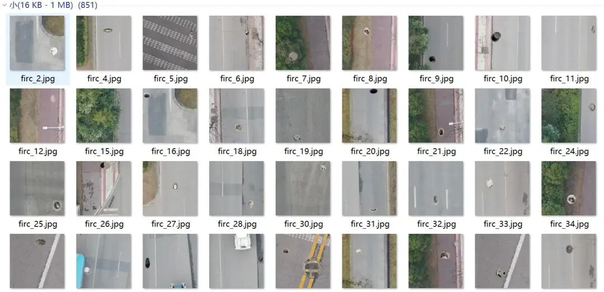
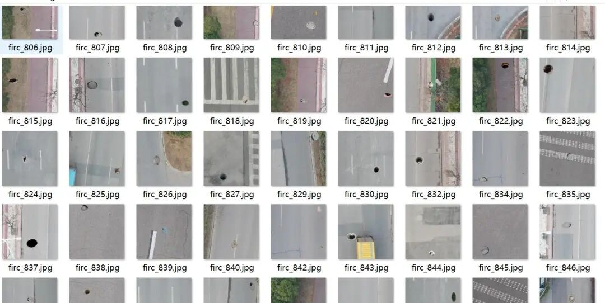
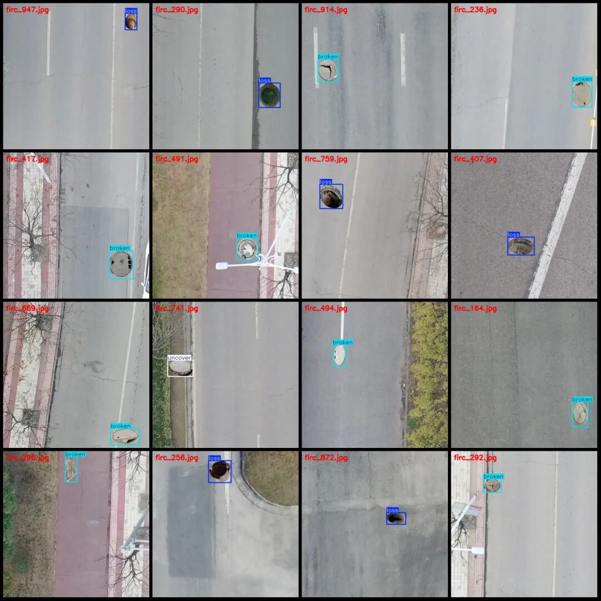
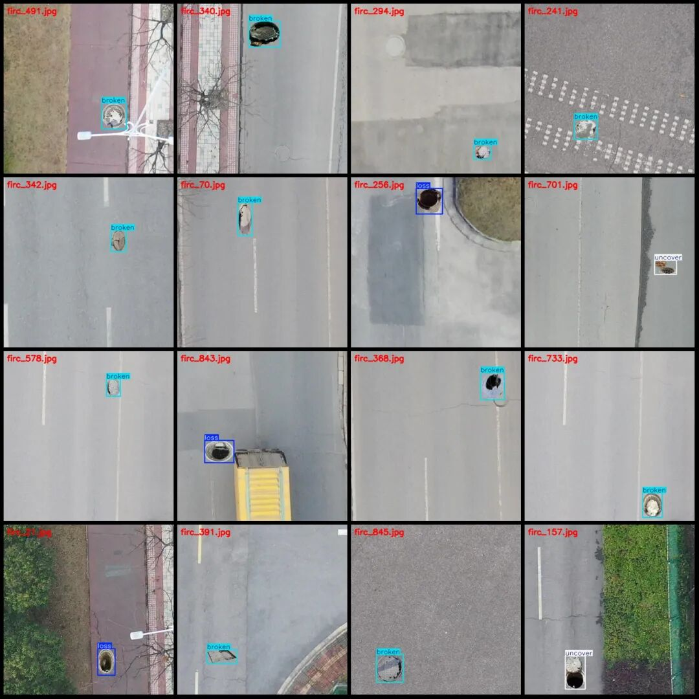

# Drone-View Smart Traffic Roadway Potholes, Cracks, and Unsealed Detection Data Set - VOC+YOLO Format - 851 Images in 3 Categories

Please note that the dataset consists of synthetic images, and specific details can be found in the images.

Dataset format: Pascal VOC format + YOLO format (txt file without split path, only containing jpg images and corresponding VOC format xml files and yolo format txt files)

Number of images (number of jpg files): 851

Number of annotations (number of xml files): 851

Number of annotations (number of txt files): 851

Label category count: 3

Label category names (note that the order of labels in the YOLO format does not correspond to this, but is based on the classes.txt file in the labels folder): ["broken", "loss", "uncover"]

Number of boxes labeled in each category:

Broken (well cover damaged) Frames = 563

Loss (Landmark Missing) = 193

Uncover (Ladder not properly covered) Frames = 102

Total frame count: 858

Number of images per category:

Broken image count = 559

Loss of image count = 193

Uncovered image count = 102

Image resolution: 512x512

Using labelImg:

Annotation rules: Draw a rectangle around the category.

Important Notice: The dataset does not have separate training, validation, and test sets; you need to partition them yourself.

Special : This dataset does not guarantee the accuracy of the trained models or weight files.

Image Preview:

Annotation example:

## Payment

Here is a pay link on Stripe ( https://buy.stripe.com/3cs8yP7sY87d0vu9AB ). Please contact me lonlonago@foxmail.com after funding $89, and I will send you a complete data files , thank you!

